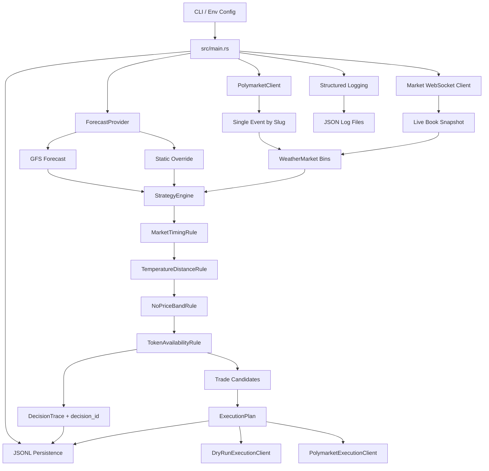

# Polymarket Weather Bot

Rust bot for evaluating Polymarket NYC highest-temperature markets. It fetches one weather event, gets a forecast high, overlays live orderbook prices from Polymarket's market WebSocket, evaluates each temperature bin through a traceable rule engine, persists the run to JSONL, and builds an execution plan.

The bot now supports real live order submission through Polymarket's Rust SDK when `DRY_RUN=false` and `POLYMARKET_PRIVATE_KEY` is configured. It can also run in a monitor loop and buy as soon as a qualifying condition appears.

## Strategy

The strategy targets daily high-temperature markets where Polymarket splits the outcome into temperature bins.

- Fetch the target event by Polymarket event slug.
- Fetch the forecast high for the target date, using GFS by default.
- Parse each market question into a `TemperatureRange`.
- Keep bins whose nearest edge is at least `4°F` away from the forecast.
- Keep only NO prices between `0.90` and `0.99`.
- Plan a `$5` NO buy for each qualifying bin.

Example: with a `50°F` forecast, bins at `44°F or below` and `56°F or above` are far enough away to be considered. They still need to pass timing, price, and token checks before becoming trade candidates.

## Architecture



## Module Layout

- `src/main.rs`: thin entrypoint that loads config, initializes logging/storage, and launches the runner.
- `src/runner.rs`: one-shot and monitor-loop orchestration. Consistently refreshes forecast + market data, evaluates the strategy, deduplicates already-submitted tokens for the current process, and submits buys when conditions trigger.
- `src/config.rs`: CLI and environment config validation.
- `src/logging.rs`: `tracing` setup with console output and rolling JSON file logs.
- `src/storage.rs`: JSONL persistence for runs, decisions, and execution plans.
- `src/weather.rs`: forecast provider abstraction, static provider, and Open-Meteo GFS provider.
- `src/polymarket.rs`: Gamma API client and weather-market parsing. Fetches one event by slug.
- `src/market_data.rs`: Polymarket market WebSocket client and in-memory best bid/ask snapshots.
- `src/strategy/engine.rs`: ordered rule-engine evaluation.
- `src/strategy/rules.rs`: timing, temperature distance, NO price band, and token availability rules.
- `src/strategy/types.rs`: strategy input, trade candidate, decision trace, and evaluation result types.
- `src/execution.rs`: execution plan, dry-run client, and live execution client backed by Polymarket's Rust SDK.

## Decision Tracing

Each market/bin evaluation receives a stable `decision_id` built from the run id, market id, and market index. The strategy engine records every rule result in a `DecisionTrace` and also emits structured logs with the same `decision_id`.

This makes it possible to answer questions like:

- Which rule rejected this bin?
- What forecast and threshold were used?
- What NO price was observed?
- Was the market rejected because of timing, price, distance, or missing token data?

The first rule that fails stops evaluation for that bin.

## Forecasting

The default forecast source is GFS via Open-Meteo:

- Base URL: `https://api.open-meteo.com/v1/gfs`
- Default location: LaGuardia-style coordinates, `40.7769, -73.8740`
- Unit: Fahrenheit
- Value used by the strategy: `daily.temperature_2m_max`

You can still force a manual forecast with:

```bash
cargo run -- \
  --forecast-source static \
  --forecast-high-f 80 \
  --target-date 2026-04-16
```

## Market Data

The bot always fetches event metadata from Gamma and always subscribes to the Polymarket market WebSocket for the event's NO token ids before strategy evaluation.

Example:

```bash
RUST_LOG=debug cargo run -- \
  --target-date 2026-04-16 \
  --event-slug highest-temperature-in-nyc-on-april-16-2026 \
  --dry-run
```

## Logging And Persistence

The app uses `tracing` rather than `println!`.

- Console logs are emitted for local visibility.
- JSON logs are written to `LOG_DIRECTORY`.
- Default log directory: `/tmp/polymarket-weather-bot`.
- Strategy decisions and execution plans are appended to `STORAGE_PATH`.
- Default storage path: `/tmp/polymarket-weather-bot/runs.jsonl`.
- The log level can be controlled with `RUST_LOG`.

## Live Monitoring And Buying

Set `MONITOR_MODE=true` to keep the bot running and reevaluating the market on a fixed interval. On each cycle it:

1. Pulls the latest weather forecast.
2. Pulls the latest event metadata.
3. Optionally overlays fresh websocket NO prices.
4. Evaluates the rule engine.
5. Submits buys for any newly triggered NO candidates.

The process keeps an in-memory set of already-submitted token ids so it does not repeatedly rebuy the same token every polling cycle within the same process run.

## Run

GFS forecast, Gamma metadata prices:

```bash
cargo run -- \
  --target-date 2026-04-16 \
  --event-slug highest-temperature-in-nyc-on-april-16-2026 \
  --dry-run
```

Static forecast override:

```bash
cargo run -- \
  --forecast-source static \
  --forecast-high-f 80 \
  --target-date 2026-04-16 \
  --event-slug highest-temperature-in-nyc-on-april-16-2026 \
  --dry-run
```

Always-on monitor mode:

```bash
MONITOR_MODE=true RUST_LOG=info cargo run -- \
  --target-date 2026-04-16 \
  --event-slug highest-temperature-in-nyc-on-april-16-2026 \
  --dry-run
```

Live trading with the Polymarket SDK:

```bash
MONITOR_MODE=true DRY_RUN=false \
POLYMARKET_PRIVATE_KEY=0xyourprivatekey \
cargo run -- \
  --target-date 2026-04-16 \
  --event-slug highest-temperature-in-nyc-on-april-16-2026
```

Equivalent environment variables are supported by the CLI:

- `FORECAST_TARGET_DATE`
- `FORECAST_SOURCE`
- `FORECAST_HIGH_F`
- `FORECAST_LATITUDE`
- `FORECAST_LONGITUDE`
- `FORECAST_TIMEZONE`
- `GFS_FORECAST_URL`
- `POLYMARKET_EVENT_SLUG`
- `POLYMARKET_GAMMA_URL`
- `POLYMARKET_CLOB_URL`
- `POLYMARKET_MARKET_WS_URL`
- `POLYMARKET_USER_WS_URL`
- `ORDERBOOK_SYNC_SECONDS`
- `MAX_BOOK_STALENESS_SECONDS`
- `PRICE_MIN`
- `PRICE_MAX`
- `DISTANCE_THRESHOLD_F`
- `ORDER_SIZE_USD`
- `DRY_RUN`
- `MONITOR_MODE`
- `POLL_INTERVAL_SECONDS`
- `LOG_DIRECTORY`
- `STORAGE_PATH`
- `POLYMARKET_PRIVATE_KEY`

## Implemented vs Remaining

Implemented:

- Single-event lookup by Polymarket event slug.
- GFS forecast provider via Open-Meteo.
- Static forecast override for testing.
- Temperature bin parsing, including `or higher`.
- Polymarket market WebSocket snapshot sync on every evaluation cycle.
- Live NO price overlay from fresh websocket best asks.
- Rule-based strategy evaluation.
- Per-decision tracing with canonical `decision_id`.
- Structured logging to JSON files.
- JSONL persistence for runs, decisions, and execution plans.
- Dry-run execution planning.
- Live order submission through Polymarket's Rust SDK.
- Always-on monitor loop that buys on new qualifying signals.
- User WebSocket client placeholder that fails explicitly until authenticated stream handling is wired.

Remaining:

- Authenticated user WebSocket subscription and fill/order event persistence.
- Full order lifecycle reconciliation.
- Position/PnL reconciliation after settlement.

## Safety Notes

Live order submission is real now, so `--dry-run false` can place market buy orders for qualifying NO tokens if `POLYMARKET_PRIVATE_KEY` is configured and the wallet is properly funded and approved on Polymarket.

WebSocket pricing is part of the core flow now, so strategy evaluation always uses a fresh websocket snapshot rather than Gamma metadata alone.
