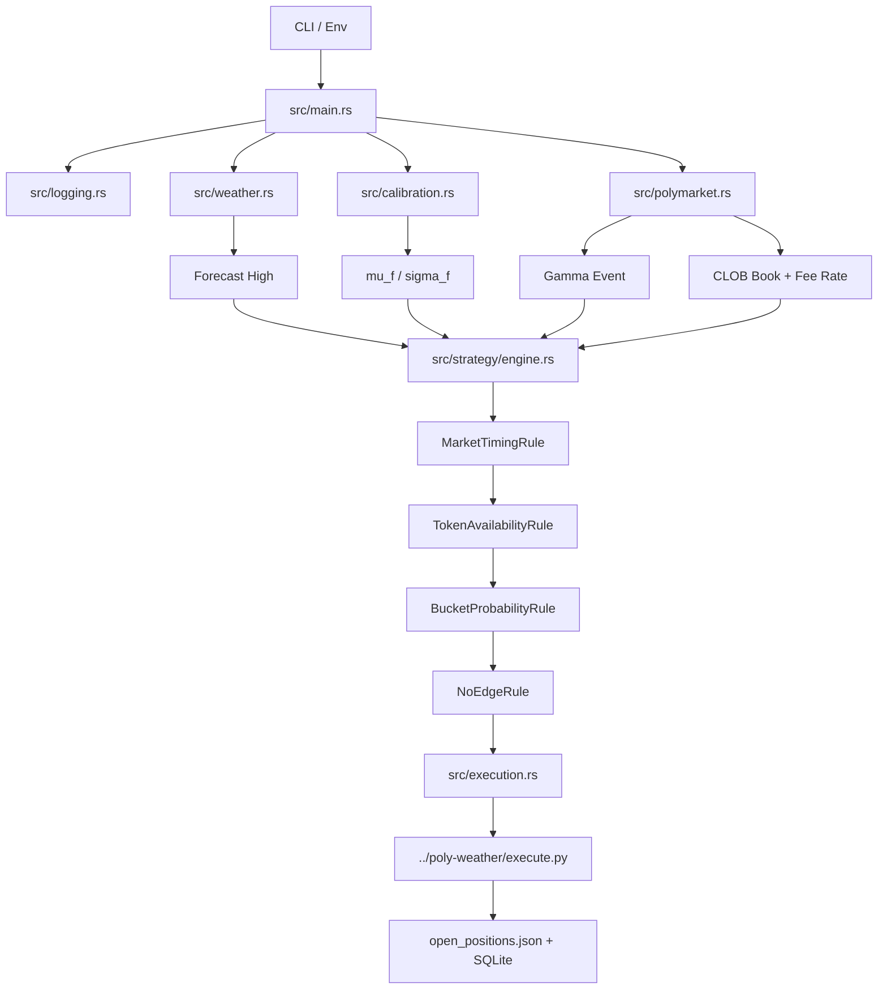

# Polymarket Weather Bot

Rust decision engine for Polymarket daily temperature markets.

This project is the scoring side of the stack. It works with the sibling
`../poly-weather` Python project, which owns SQLite storage, settlement,
calibration fitting, and the execution bridge.

## Current Behavior

Each pass of the bot does the following:

1. Resolve the target market date from `--target-date` or from the current UTC time.
2. Refresh the forecast high from NWS on its own cadence, unless `--forecast-high-f` overrides it.
3. Load `calibration.json` and apply station/month/lead-time adjustments.
4. Load `open_positions.json` so the bot does not rebuy bins already held.
5. Fetch the Gamma event for the generated city/date slug.
6. Enrich each market with CLOB order book depth and fee-rate data.
7. Evaluate every enabled strategy profile from `strategies.toml`.
8. Write `execution_plan.json`.
9. Invoke `../poly-weather/execute.py` to record paper positions or submit live orders.

In loop mode, the bot reevaluates the live book every `POLL_INTERVAL_SECS` and
refreshes the forecast every `FORECAST_REFRESH_SECS`. The defaults are `15`
seconds for market evaluation and `1800` seconds (30 minutes) for forecast refresh.

## Implemented Strategy

The old distance-band heuristic has been replaced by a calibrated EV workflow.

For each weather bin, the bot currently:

- Parses the market question into a `TemperatureRange`
- Estimates bucket probability from a Gaussian distribution using calibrated `mu_f` and `sigma_f`
- Walks the NO-side ask book to compute a VWAP effective ask for the requested share size
- Fetches the token-specific fee rate from CLOB
- Applies a rule chain:
  - `MarketTimingRule`
  - `TokenAvailabilityRule`
  - `BucketProbabilityRule`
  - `NoEdgeRule`

Enabled strategy profiles live in `strategies.toml`. Right now the shipped file has:

- `base_ev`: enabled
- `aggressive_tail`: disabled

## Architecture



## Module Layout

- `src/main.rs`: orchestration loop, target-date resolution, plan writing, Python bridge invocation
- `src/config.rs`: CLI and environment configuration
- `src/weather.rs`: NWS forecast provider plus static forecast override
- `src/calibration.rs`: runtime lookup of `beta_f` and `sigma_f`
- `src/polymarket.rs`: Gamma lookup, bucket parsing, CLOB order book fetch, fee-rate fetch, VWAP effective ask
- `src/strategy/registry.rs`: strategy profiles loaded from `strategies.toml`
- `src/strategy/engine.rs`: rule-engine evaluation and candidate generation
- `src/strategy/rules.rs`: timing, token, probability, and EV rules
- `src/strategy/types.rs`: strategy input, trade candidates, traces, and timing helpers
- `src/execution.rs`: JSON execution plan model and serializer
- `src/logging.rs`: console + JSON file logging

## Decision Tracing

Each market evaluation gets a stable `decision_id` built from the run id, market id,
and market index. Every rule result is recorded in the trace and emitted to the log.

That makes it easy to answer:

- Which rule rejected this market?
- What forecast inputs were used?
- What bucket probability was computed?
- What effective ask and fee rate were used?
- Which markets became trade candidates?

## Running It

Windows launcher:

```powershell
cd F:\Polymark\poly-weather-bot
run_bot.bat
run_bot.bat --run-loop
run_bot.bat --run-loop --dry-run=false
```

Direct binary:

```bash
cd /mnt/f/Polymark/poly-weather-bot
./target/release/polymarket-weather-bot.exe --dry-run
./target/release/polymarket-weather-bot.exe --run-loop --dry-run
```

Useful flags:

- `--city`
- `--station-code`
- `--target-date`
- `--forecast-high-f`
- `--poll-interval-secs`
- `--forecast-refresh-secs`
- `--min-ev-threshold`
- `--desired-shares`
- `--order-size-usd`
- `--max-total-stake-usd`
- `--max-open-positions`
- `--dry-run`
- `--run-loop`

Important paths default to the sibling Python project:

- `../poly-weather/calibration.json`
- `../poly-weather/open_positions.json`
- `../poly-weather/execution_plan.json`
- `../poly-weather/execute.py`

## Logging

The bot uses `tracing` for both console and JSON log output.

- Console logs are emitted immediately.
- Rolling JSON logs are written under `LOG_DIRECTORY`.
- The default log directory is `logs`.
- `RUST_LOG` controls verbosity.

## Safety Notes

- Dry-run mode is the default.
- Live order submission is handled by the Python bridge, not by Rust directly.
- If `execute.py` is missing or fails, the bot still writes the execution plan and logs the failure.
- If calibration cannot be loaded, the bot falls back to `beta=0` and `sigma=2`.
