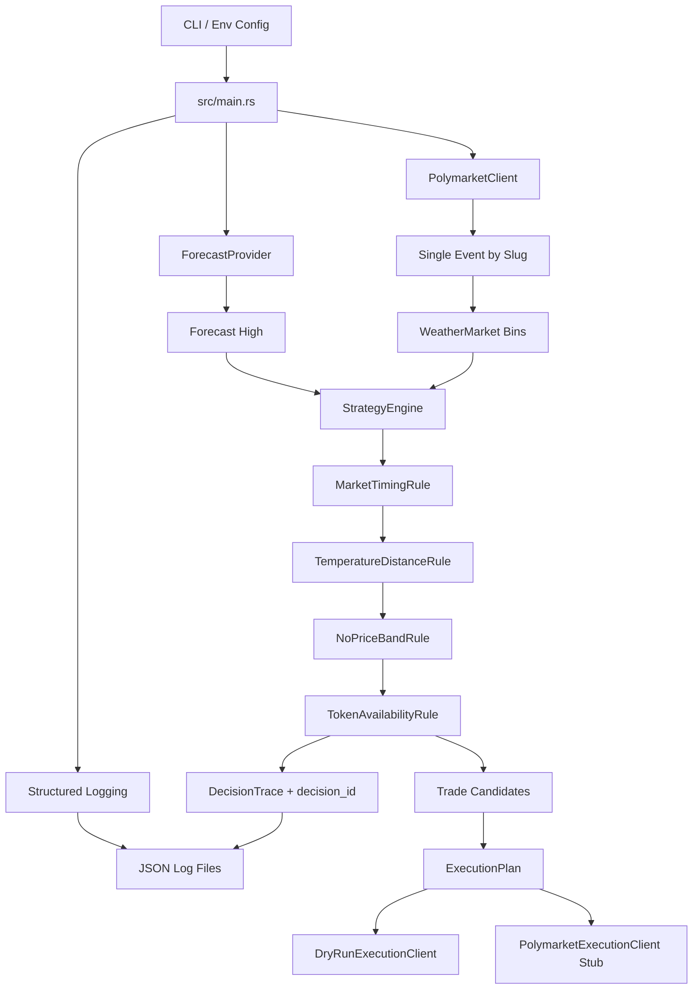

# Polymarket Weather Bot

Rust bot for evaluating Polymarket NYC highest-temperature markets. The current implementation is a dry-run-first architecture: it fetches one weather event, evaluates each temperature bin through a traceable rule engine, logs every decision step, and builds an execution plan without submitting live orders.

## Strategy

The strategy targets daily high-temperature markets where Polymarket splits the outcome into temperature bins.

- Fetch the target event by Polymarket event slug.
- Use a forecast high for the target date.
- Parse each market question into a `TemperatureRange`.
- Keep bins whose nearest edge is at least `4°F` away from the forecast.
- Keep only NO prices between `0.90` and `0.99`.
- Plan a `$5` NO buy for each qualifying bin.

Example: with a `50°F` forecast, bins at `44°F or below` and `56°F or above` are far enough away to be considered. They still need to pass the price and token checks before becoming trade candidates.

## Architecture



## Module Layout

- `src/main.rs`: orchestration layer. Loads config, initializes logging, fetches forecast/event data, runs the strategy engine, and calls the execution client.
- `src/config.rs`: CLI and environment config validation.
- `src/logging.rs`: `tracing` setup with console output and rolling JSON file logs.
- `src/weather.rs`: forecast provider abstraction. Currently includes a static forecast provider.
- `src/polymarket.rs`: Gamma API client and weather-market parsing. Currently fetches one event by slug.
- `src/strategy/engine.rs`: ordered rule-engine evaluation.
- `src/strategy/rules.rs`: individual rules such as timing, temperature distance, NO price band, and token availability.
- `src/strategy/types.rs`: strategy input, trade candidate, decision trace, and evaluation result types.
- `src/execution.rs`: execution plan plus dry-run and live-client abstractions.

## Decision Tracing

Each market/bin evaluation receives a stable `decision_id` built from the run id, market id, and market index. The strategy engine records every rule result in a `DecisionTrace` and also emits structured logs with the same `decision_id`.

This makes it possible to answer questions like:

- Which rule rejected this bin?
- What forecast and threshold were used?
- What NO price was observed?
- Was the market rejected because of timing, price, distance, or missing token data?

The first rule that fails stops evaluation for that bin.

## Logging

The app uses `tracing` rather than `println!`.

- Console logs are emitted for local visibility.
- JSON logs are written to `LOG_DIRECTORY`.
- Default log directory: `/tmp/polymarket-weather-bot`.
- The log level can be controlled with `RUST_LOG`.

Example:

```bash
RUST_LOG=debug cargo run -- \
  --target-date 2026-04-16 \
  --forecast-high-f 80 \
  --event-slug highest-temperature-in-nyc-on-april-16-2026 \
  --dry-run
```

## Current Data Flow

1. `Cli` parses runtime settings.
2. `AppConfig` validates thresholds and paths.
3. `StaticForecastProvider` returns the configured forecast high.
4. `PolymarketClient` fetches the configured event by slug from Gamma.
5. `TemperatureRange` parses labels such as `77F or below`, `78-79F`, and `96F or higher`.
6. `StrategyEngine` evaluates each bin through ordered rules.
7. `ExecutionPlan` converts approved candidates into planned NO orders.
8. `DryRunExecutionClient` logs the plan without submitting orders.

## Run

```bash
cargo run -- \
  --target-date 2026-04-16 \
  --forecast-high-f 80 \
  --event-slug highest-temperature-in-nyc-on-april-16-2026 \
  --dry-run
```

Equivalent environment variables are supported by the CLI:

- `FORECAST_TARGET_DATE`
- `FORECAST_HIGH_F`
- `POLYMARKET_EVENT_SLUG`
- `POLYMARKET_GAMMA_URL`
- `POLYMARKET_CLOB_URL`
- `PRICE_MIN`
- `PRICE_MAX`
- `DISTANCE_THRESHOLD_F`
- `ORDER_SIZE_USD`
- `DRY_RUN`
- `LOG_DIRECTORY`

## Implemented vs Planned

Implemented:

- Single-event lookup by Polymarket event slug.
- Temperature bin parsing, including `or higher`.
- Rule-based strategy evaluation.
- Per-decision tracing with canonical `decision_id`.
- Structured logging to JSON files.
- Dry-run execution planning.
- Live execution client stub with auth intentionally empty.

Planned:

- GFS forecast provider.
- Polymarket CLOB WebSocket orderbook sync.
- Live NO price calculation from orderbook state instead of Gamma metadata.
- Authenticated order submission.
- User WebSocket fill/order tracking.
- Persistence for runs, decisions, orders, fills, and PnL.

## Safety Notes

Live order submission is not implemented yet. If `--dry-run false` is used, the live execution client currently fails intentionally until Polymarket authentication and CLOB order placement are wired.

The current forecast provider is static. It is useful for testing the strategy flow, but it is not yet a live weather integration.
