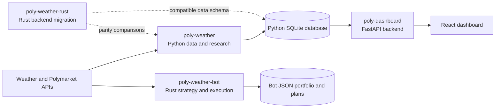

# Poly

A monorepo containing the four Polymarket weather projects from `lynx-canadensis`.
The initial import preserves their default-branch files and original Git commits.

## Projects

| Folder | Role |
| --- | --- |
| [`poly-weather/`](poly-weather/) | Python weather/market data collection, SQLite storage, calibration, backtesting, parameter sweeps, settlement and an older execution bridge. |
| [`poly-weather-rust/`](poly-weather-rust/) | Rust migration of the Python data/research tools, with a parity harness and paper execution. Live order submission is deliberately unsupported. |
| [`poly-weather-bot/`](poly-weather-bot/) | Event-driven Rust weather strategy and execution engine. Uses REST/weather polling and market websockets; supports paper and live execution. Checked-in configuration sets `dry_run = true`. |
| [`poly-dashboard/`](poly-dashboard/) | FastAPI backend and React/Vite frontend for backtests, market observations and position/PnL monitoring. |

The original folder names remain siblings because the dashboard and Rust parity
harness already use those paths. Each project retains its dependency manifest and
lockfile; this import does not change dependency versions or merge Cargo locks.

## Current architecture



The diagram describes the checked-in code. It does not establish what is currently
deployed or running. In particular, the current bot's JSON portfolio is not wired
into the dashboard's SQLite position queries.

## Development

Install dependencies for the project you are working on, using its own manifest.
For Python, use a virtual environment; the API also needs its own requirements.

Dashboard frontend, from this directory:

```sh
npm --prefix poly-dashboard/apps/web ci
npm --prefix poly-dashboard run dev:web
```

Dashboard API, from this directory:

```sh
python -m pip install -r poly-weather/requirements.txt -r poly-dashboard/apps/api/requirements.txt
python -m uvicorn --app-dir poly-dashboard/apps/api main:app --host 127.0.0.1 --port 8000
```

Backend strategy metadata, from this directory:

```sh
python poly-weather/backtest.py --list-strategies
```

Build each Rust project from its own directory with `cargo build --locked`.
The Rust migration includes bundled SQLite; its existing documentation records
Windows C-toolchain requirements and a previously working WSL build setup.
The bot resolves config/state paths from its working directory; run its commands
from `poly-weather-bot/`. Its current CLI accepts `--config`, while several older
README/launcher examples describe flags that no longer exist.

These are developer entry points, not a claim that all cross-project integration
is working. Read [the assessment](docs/ASSESSMENT.md) for the known issues.

## History and migration verification

Original branch heads are preserved as `archive/<source-repo>/<source-branch>`.
Those branches contain their original standalone trees. Use `main` for the
combined monorepo. Original commit hashes remain unchanged; commits before an
import still show the paths they had in the original standalone repository.

```sh
python tools/verify_import.py
```

The verifier checks imported tree identity, archived branch heads, and retention
of every source commit recorded in [the manifest](docs/source-repositories.json).
GitHub issues, pull requests, secrets, settings and deployment configuration are
not part of this Git import.

The imported snapshots include previously tracked database/log/portfolio files.
The root ignore rules prevent new matching artifacts from being added by default;
they do not remove existing tracked files or historical content. A separate data
cleanup should retain any research data needed for backtests.
